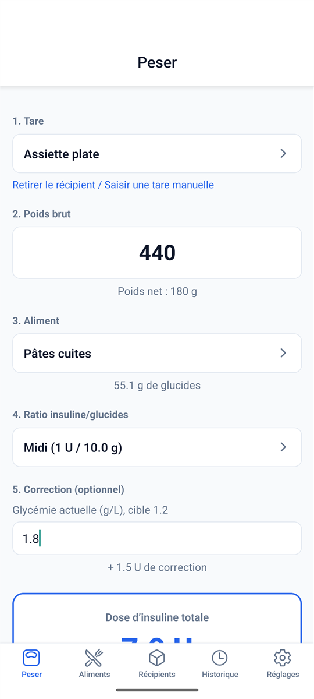
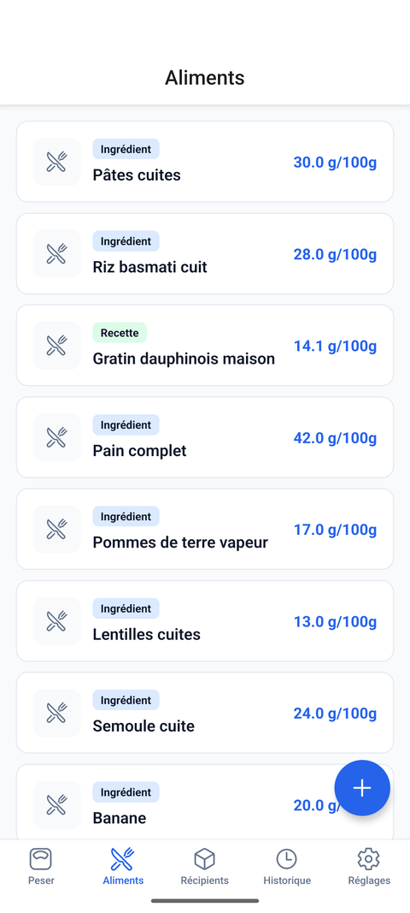
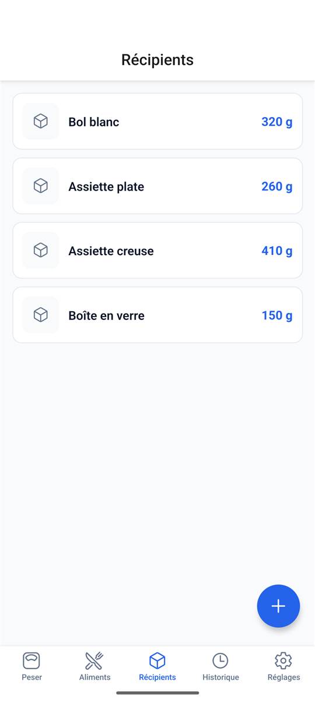
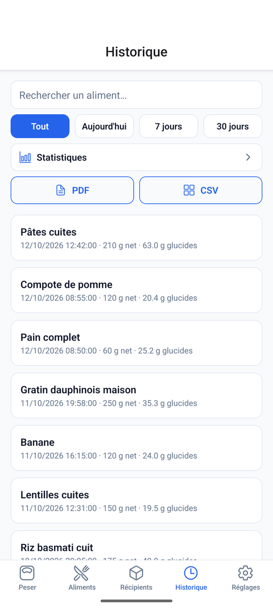
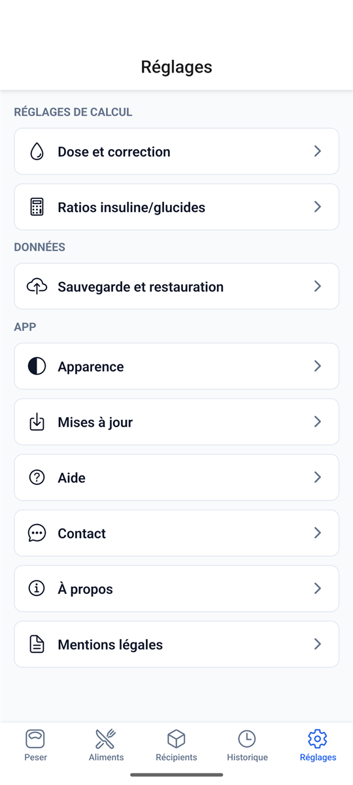
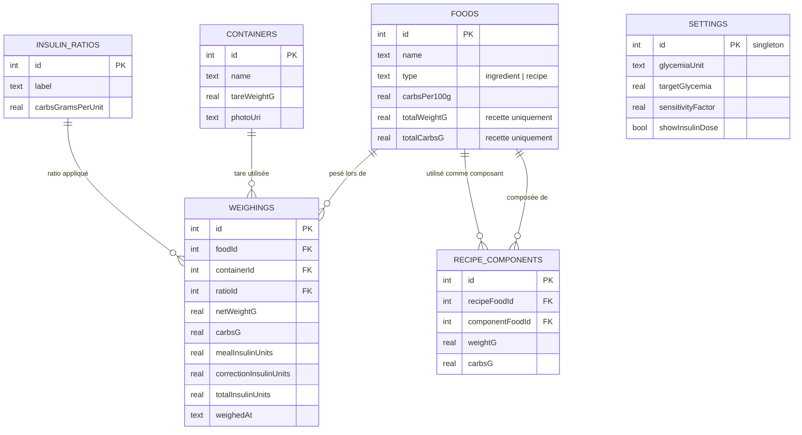

<div align="center">


# GlucoDose

**Le calculateur de glucides pour tes repas : tu pèses, il compte.**

Pèse ton assiette, choisis l'aliment : GlucoDose te donne les glucides du repas en un instant.
Si tu es sous insuline, il peut aussi en déduire ta dose.

[](https://github.com/Forthtilliath/glucodose/releases/latest)


[**Télécharger l'application**](https://github.com/Forthtilliath/glucodose/releases/latest)

</div>

---

> [!CAUTION]
> **GlucoDose n'est pas un dispositif médical.** C'est un outil d'aide au calcul. Les valeurs que tu y entres (ratios, glycémie cible, facteur de sensibilité) doivent venir de ton équipe soignante. Vérifie toujours un résultat avant de t'en servir pour une injection. En cas de doute, fie-toi à ton jugement et à tes soignants, jamais uniquement à l'application.

## Compter les glucides, sans la calculette

Avec un diabète, chaque repas commence par la même question : *combien de glucides dans mon assiette ?* Pour y répondre, il faut d'habitude :

- se souvenir du poids de son bol ou de son assiette, pour le retirer de la pesée ;
- retrouver la teneur en glucides de chaque aliment, sur l'emballage ou dans une table ;
- faire le calcul, de tête ou à la calculette, à chaque repas ;
- et, sous insuline, convertir ensuite ces glucides en unités.

C'est long, répétitif, et une erreur de calcul est vite arrivée, surtout quand on a faim ou qu'on est pressé.

**GlucoDose fait tout ça à ta place.** Il retient le poids de tes récipients et la valeur de tes aliments. Une fois l'assiette pesée, le total des glucides s'affiche aussitôt.

## Aperçu

<div align="center">
<table>
<tr>
<td align="center" width="20%"><br/><sub><b>Peser un repas</b></sub></td>
<td align="center" width="20%"><br/><sub><b>Tes aliments</b></sub></td>
<td align="center" width="20%"><br/><sub><b>Tes récipients</b></sub></td>
<td align="center" width="20%"><br/><sub><b>Ton historique</b></sub></td>
<td align="center" width="20%"><br/><sub><b>Réglages</b></sub></td>
</tr>
</table>
</div>

## Comment ça marche

1. **Pose ton assiette sur la balance** et choisis le récipient utilisé : son poids à vide est déduit automatiquement.
2. **Choisis l'aliment** : un aliment de ta liste, une de tes recettes, ou un aliment de la table officielle Ciqual. Tu peux aussi le dicter à voix haute.
3. **Lis le résultat** : les glucides du repas s'affichent instantanément.
4. **Sous insuline ?** Active le calcul de dose dans les réglages, puis choisis ton ratio et, si besoin, indique ta glycémie : la dose du repas et la correction s'ajoutent au résultat.

Le repas est ensuite enregistré dans ton historique. Une erreur ? Un tap sur « Annuler » suffit.

### Un exemple concret

> Tu manges des pâtes. L'assiette pleine pèse **440 g** ; vide, elle pèse **260 g**.
>
> - Poids des pâtes : 440 − 260 = **180 g**
> - Les pâtes cuites contiennent environ **30 g de glucides pour 100 g**
> - Glucides du repas : 180 × 30 ÷ 100 = **54 g**
>
> **Avec le calcul de dose activé**, et par exemple un ratio d'1 unité pour 10 g de glucides :
>
> - Dose repas : 54 ÷ 10 = **5,4 unités**
> - Glycémie à 1,80 g/L pour une cible à 1,20 g/L, avec 1 unité qui fait baisser de 0,40 g/L : correction de (1,80 − 1,20) ÷ 0,40 = **1,5 unité**
> - Total : **6,9 unités**
>
> Toi, tu n'as fait que peser et choisir « pâtes ». *Ces chiffres sont des exemples : tes propres valeurs viennent de ton équipe soignante.*

## Ce que GlucoDose t'apporte

### ⏱️ Du temps gagné à chaque repas
- **Tes récipients mémorisés**, avec une photo pour les reconnaître d'un coup d'œil : plus besoin de retenir le poids de chaque bol.
- **Tes aliments mémorisés**, et les plus récents proposés en premier.
- **Plus de 3 000 aliments de la table Ciqual** (base officielle de l'Anses), consultables sans connexion internet.
- **Tes recettes maison** : pèse les ingrédients une seule fois, GlucoDose calcule les glucides du plat. Tu le réutilises ensuite comme n'importe quel aliment.
- **Recherche vocale** dans toutes les listes, pratique quand on a les mains prises.
- **Raccourcis** : un appui long sur l'icône de l'app ouvre directement la pesée.

### ✅ Moins d'erreurs de calcul
- Aucun calcul à faire de tête : la soustraction du récipient, la règle de trois et la conversion en unités sont faites pour toi.
- Une alerte s'affiche si le poids saisi est plus petit que celui du récipient.
- Chaque repas enregistré garde les valeurs utilisées ce jour-là : si tu modifies un aliment ou un ratio plus tard, ton historique reste exact.

### 💉 Une dose d'insuline en option
- **Plusieurs ratios** possibles, par exemple un pour le matin et un pour le soir, puisque les besoins varient souvent au fil de la journée.
- **Correction** selon ta glycémie, en g/L ou en mmol/L.
- **Désactivée par défaut** : l'application n'affiche que les glucides tant que tu n'actives pas le calcul de dose dans *Réglages → Dose et correction*.

### 🩺 Un suivi à partager avec tes soignants
- **Historique** de tous tes repas pesés, filtrable par aliment et par période.
- **Export PDF** à envoyer ou à imprimer pour ton rendez-vous, ou **export tableur** (CSV) pour l'analyser toi-même.
- **Statistiques** : glucides moyens par jour, nombre de pesées par semaine, aliments les plus fréquents.

### 🔒 Tes données restent les tiennes
- **Aucun compte à créer**, aucune publicité, aucun suivi.
- **Tout est stocké sur ton téléphone** et fonctionne sans internet.
- **Sauvegarde facultative sur ton Google Drive**, chiffrée et rangée dans un dossier privé que seule l'application peut ouvrir. Pratique pour changer de téléphone.

## Petit lexique

| Terme | En clair |
|---|---|
| **Glucides** | Les sucres et féculents d'un aliment, ceux qui font monter la glycémie. On les compte en grammes. |
| **Tare** | Le poids du récipient vide, à retirer de la pesée pour n'avoir que l'aliment. |
| **Ratio insuline/glucides** | Le nombre de grammes de glucides « couverts » par 1 unité d'insuline. Fixé avec ton équipe soignante. |
| **Facteur de sensibilité** | De combien 1 unité d'insuline fait baisser ta glycémie. Sert à calculer la correction. |
| **Correction** | La petite dose ajoutée quand la glycémie avant le repas est au-dessus de ta cible. |
| **Ciqual** | La table de composition nutritionnelle des aliments publiée par l'Anses, l'agence sanitaire française. |

## Installer GlucoDose

GlucoDose est disponible **pour Android**. Il n'est pas (encore) sur le Play Store : il s'installe depuis cette page.

1. Sur ton téléphone, ouvre la [**dernière version**](https://github.com/Forthtilliath/glucodose/releases/latest) et télécharge le fichier `.apk`.
2. Ouvre le fichier téléchargé. Android te demande d'autoriser l'installation depuis ton navigateur : accepte.
3. C'est installé ! Les mises à jour suivantes te sont proposées directement dans l'application.

> [!TIP]
> Il te faut une balance de cuisine, n'importe laquelle. Commence par enregistrer tes bols et assiettes habituels (onglet *Récipients*) : c'est ce qui fait gagner le plus de temps ensuite.

## Questions fréquentes

<details>
<summary><b>Je ne suis pas sous insuline, l'application m'est-elle utile ?</b></summary>

Oui. Compter les glucides est son rôle premier, et le calcul de dose est désactivé par défaut : tu ne vois que les glucides, sans rien à configurer.
</details>

<details>
<summary><b>Est-ce que GlucoDose remplace mon médecin ou mon diabétologue ?</b></summary>

Non. Il fait les calculs à partir des valeurs que ton équipe soignante t'a données, mais il ne décide de rien à ta place. Garde toujours un regard critique sur le résultat.
</details>

<details>
<summary><b>Faut-il une connexion internet ?</b></summary>

Non. Tout fonctionne hors ligne, y compris la recherche dans la table Ciqual. Internet n'est utile que pour la sauvegarde Google Drive (facultative) et la vérification des mises à jour.
</details>

<details>
<summary><b>Qui peut voir mes données ?</b></summary>

Personne d'autre que toi : elles restent sur ton téléphone, et l'application n'envoie rien à personne. Si tu actives la sauvegarde Google Drive, le fichier est chiffré avant de quitter ton téléphone, puis rangé dans un dossier caché de ton Drive que seule GlucoDose peut ouvrir : il n'apparaît pas dans tes fichiers et aucune autre application n'y a accès.
</details>

<details>
<summary><b>Et si je change de téléphone ?</b></summary>

Avec la sauvegarde Google Drive, il suffit de te reconnecter sur le nouveau téléphone pour tout retrouver. Sans Drive, exporte un fichier de sauvegarde depuis *Réglages → Sauvegarde et restauration* et importe-le sur le nouvel appareil (pense à noter ta clé de secours, affichée sur le même écran).
</details>

<details>
<summary><b>Est-ce disponible sur iPhone ?</b></summary>

Non, GlucoDose est développé uniquement pour Android.
</details>

<details>
<summary><b>C'est vraiment gratuit ?</b></summary>

Oui : pas de publicité, pas d'abonnement, pas de version payante. Si l'application te rend service, tu peux soutenir son développement en m'[offrant un café](https://buymeacoffee.com/forthtilliath) ☕.
</details>

## Soutenir le projet

GlucoDose est développé sur mon temps libre. Tu peux aider :

- en [signalant un problème ou en proposant une idée](https://github.com/Forthtilliath/glucodose/issues) ;
- en parlant de l'application autour de toi ;
- en [m'offrant un café](https://buymeacoffee.com/forthtilliath) ☕.

---

## Pour les développeurs

Cette partie s'adresse à celles et ceux qui veulent compiler l'application ou contribuer.

<details>
<summary><b>Stack technique</b></summary>

| Domaine | Choix |
|---|---|
| Framework | [Expo](https://expo.dev) (SDK 57) + [Expo Router](https://docs.expo.dev/router/introduction/) |
| Langage | TypeScript strict |
| Base de données | SQLite embarqué (`expo-sqlite`) via [Drizzle ORM](https://orm.drizzle.team/docs/get-started/expo-new) : schéma typé, migrations versionnées, requêtes réactives (`useLiveQuery`) |
| Photos | `expo-image-picker` + `expo-file-system` |
| État | Hooks React + requêtes SQL réactives, sans state manager global |
| Données | 100 % locales, aucun backend, aucun compte |

</details>

<details>
<summary><b>Méthode de calcul</b></summary>

```
glucides pesés   = poids net (poids brut − tare) × (glucides pour 100 g) / 100
dose repas       = glucides pesés ÷ ratio insuline/glucides
dose correction  = max(0, (glycémie actuelle − glycémie cible) ÷ facteur de sensibilité)
dose totale      = dose repas + dose correction
```

Les glucides pour 100 g sont une propriété stable de l'aliment, alors que le ratio est un paramètre personnel qui varie selon le repas et dans le temps : les deux sont stockés séparément. Chaque pesée fige les valeurs utilisées (snapshot), pour qu'aucune modification ultérieure ne change une dose déjà calculée. Toutes les formules sont dans [`src/lib/insulin.ts`](./src/lib/insulin.ts).

</details>

<details>
<summary><b>Modèle de données</b></summary>



</details>

<details>
<summary><b>Structure du projet</b></summary>

```
src/
├── app/                  # Écrans (Expo Router)
│   ├── _layout.tsx       # Layout racine : migrations DB + splash screen
│   └── (tabs)/           # Peser, aliments, récipients, historique, réglages
├── db/                   # Schéma Drizzle, connexion SQLite, écritures
├── lib/                  # Calculs, Ciqual, sauvegarde, exports PDF/CSV
├── components/           # Composants propres à l'app
└── theme/                # Couleurs
assets/data/ciqual.json   # Table Ciqual pré-traitée
drizzle/                  # Migrations SQL générées (versionnées)
plugins/                  # Config plugins Expo (signature release, ABI)
scripts/                  # Import Ciqual, génération des icônes
```

</details>

<details>
<summary><b>Démarrer le projet</b></summary>

Prérequis : Node.js ≥ 20 et un téléphone ou émulateur Android.

```bash
npm install
npx expo run:android
```

> [!IMPORTANT]
> **Expo Go ne suffit pas** : l'app utilise des modules natifs (photos, recherche vocale, raccourcis d'icône). Sans eux, l'écran Peser plante dès l'ouverture. Il faut un build de développement (`npx expo run:android`).

| Commande | Effet |
|---|---|
| `npm run start` | Serveur de développement Expo |
| `npm run android` | Build et lancement sur Android |
| `npm run lint` | Lint du projet |
| `npm test` | Tests (Jest) |
| `npx tsc --noEmit` | Vérification TypeScript |
| `npx drizzle-kit generate` | Génère une migration après modification de `src/db/schema.ts` |
| `npm run import-ciqual` | Reconvertit le fichier Ciqual (Anses) en `assets/data/ciqual.json` |
| `npm run generate-icons` | Régénère les icônes de l'app |

**Migrations** : le schéma (`src/db/schema.ts`) est la source de vérité. `npx drizzle-kit generate` produit un fichier SQL dans `drizzle/`, appliqué automatiquement au démarrage. Ne jamais modifier une migration publiée : en générer une nouvelle.

</details>

<details>
<summary><b>Signer l'APK de release</b></summary>

L'APK de release est signé avec une clé propre à GlucoDose, jamais avec le `debug.keystore` public de React Native (plugin [`plugins/withReleaseSigning.js`](./plugins/withReleaseSigning.js)). Sans cette clé, `gradlew assembleRelease` échoue (« Keystore file not set »).

1. Générer la clé une seule fois, **hors du dépôt**, et la sauvegarder (gestionnaire de mots de passe) : la perdre empêche toute mise à jour de l'app installée.

   ```powershell
   keytool -genkeypair -v -storetype PKCS12 -keyalg RSA -keysize 2048 -validity 10000 -alias glucodose-upload -keystore "$env:USERPROFILE\keys\glucodose-upload.keystore"
   ```

2. Déclarer son emplacement et son mot de passe dans `~/.gradle/gradle.properties` (jamais dans `android/`, régénéré par `expo prebuild`) :

   ```properties
   GLUCODOSE_UPLOAD_STORE_FILE=C:/Users/<toi>/keys/glucodose-upload.keystore
   GLUCODOSE_UPLOAD_STORE_PASSWORD=...
   GLUCODOSE_UPLOAD_KEY_ALIAS=glucodose-upload
   GLUCODOSE_UPLOAD_KEY_PASSWORD=...
   ```

3. Vérifier avec `cd android && ./gradlew :app:signingReport` (section `Variant: release`).

L'APK n'embarque que le code natif des téléphones ARM (plugin [`plugins/withAndroidAbis.js`](./plugins/withAndroidAbis.js)).

</details>

<details>
<summary><b>Sauvegarde Google Drive et chiffrement</b></summary>

La sauvegarde vient des paquets partagés [`@forthtilliath/expo-backup`](https://github.com/Forthtilliath/forthtilliath-packages/tree/main/packages/expo-backup#readme) et `expo-backup-ui`, configurés dans [`src/lib/backupManager.ts`](./src/lib/backupManager.ts) :

- **Chiffrement obligatoire** (données de santé) : fichiers exportés et copie Drive sont chiffrés (XChaCha20-Poly1305) avec une clé générée par l'app, gardée dans le Keystore Android et déposée dans le dossier privé Drive de l'app. Une clé de secours est consultable dans l'écran pour qui n'utilise pas Drive. Les anciens exports en clair restent importables.
- **Drive** : uniquement le dossier caché de l'app (scope `drive.appdata`), envoi automatique quelques secondes après chaque modification.
- **`android.allowBackup: false`** (`app.json`) : la sauvegarde automatique d'Android copierait sinon la base en clair hors du téléphone.

Configuration Google Cloud (une fois) : activer l'API Google Drive, déclarer le scope `drive.appdata` dans l'écran de consentement OAuth, puis créer un client OAuth **Android** avec le nom de paquet `com.forth.glucodose` et l'empreinte **SHA-1 de la clé de release** (`keytool -list -v -keystore glucodose-upload.keystore`). Détails : README d'`expo-backup`.

</details>

<details>
<summary><b>Versions et contributions</b></summary>

- Les changements sont suivis dans [`CHANGELOG.md`](./CHANGELOG.md) (format [Keep a Changelog](https://keepachangelog.com/fr/1.1.0/), versions [semver](https://semver.org/lang/fr/)).
- La branche `main` est protégée : tout changement passe par une branche dédiée et une Pull Request.

</details>

## Licence

GlucoDose est distribué sous [licence MIT](./LICENSE) : tu peux librement l'utiliser, le modifier et le partager.
