

# GlucoDose

**Le calculateur de glucides pour tes repas : tu pèses, il compte.**

Pèse ton assiette, choisis l'aliment : GlucoDose te donne les glucides du repas en un instant.
Si tu es sous insuline, il peut aussi en déduire ta dose.

[**Télécharger l'application**](https://github.com/Forthtilliath/glucodose/releases/latest)

---

> [!CAUTION]
> **GlucoDose n'est pas un dispositif médical.** C'est un outil d'aide au calcul. Les valeurs que tu y entres (ratios, glycémie cible, facteur de sensibilité) doivent venir de ton équipe soignante. Vérifie toujours un résultat avant de t'en servir pour une injection. En cas de doute, fie-toi à ton jugement et à tes soignants, jamais uniquement à l'application.

## Sommaire

- [Compter les glucides, sans la calculette](#compter-les-glucides-sans-la-calculette)
- [Aperçu](#aperçu)
- [Comment ça marche](#comment-ça-marche)
- [Guide d'utilisation](#guide-dutilisation)
  - [Premiers pas](#premiers-pas)
  - [Peser un repas](#peser-un-repas)
  - [Tes récipients](#tes-récipients)
  - [Tes aliments](#tes-aliments)
  - [La table Ciqual](#la-table-ciqual)
  - [Tes recettes](#tes-recettes)
  - [Historique et statistiques](#historique-et-statistiques)
  - [Dose d'insuline et correction](#dose-dinsuline-et-correction)
  - [Ratios insuline/glucides](#ratios-insulineglucides)
  - [Sauvegarde et changement de téléphone](#sauvegarde-et-changement-de-téléphone)
  - [Mises à jour](#mises-à-jour)
  - [Apparence](#apparence)
  - [Raccourcis et recherche vocale](#raccourcis-et-recherche-vocale)
- [Ce que GlucoDose t'apporte](#ce-que-glucodose-tapporte)
- [Petit lexique](#petit-lexique)
- [Installer GlucoDose](#installer-glucodose)
- [Questions fréquentes](#questions-fréquentes)
- [Soutenir le projet](#soutenir-le-projet)

## Compter les glucides, sans la calculette

Avec un diabète, chaque repas commence par la même question : *combien de glucides dans mon assiette ?* Pour y répondre, il faut d'habitude :

- se souvenir du poids de son bol ou de son assiette, pour le retirer de la pesée ;
- retrouver la teneur en glucides de chaque aliment, sur l'emballage ou dans une table ;
- faire le calcul, de tête ou à la calculette, à chaque repas ;
- et, sous insuline, convertir ensuite ces glucides en unités.

C'est long, répétitif, et une erreur de calcul est vite arrivée, surtout quand on a faim ou qu'on est pressé.

**GlucoDose fait tout ça à ta place.** Il retient le poids de tes récipients et la valeur de tes aliments. Une fois l'assiette pesée, le total des glucides s'affiche aussitôt.

## Aperçu

<table>
<tr>
<td align="center" width="20%"> <b>Peser un repas</b></td>
<td align="center" width="20%"> <b>Tes aliments</b></td>
<td align="center" width="20%"> <b>Tes récipients</b></td>
<td align="center" width="20%"> <b>Ton historique</b></td>
<td align="center" width="20%"> <b>Réglages</b></td>
</tr>
</table>

## Comment ça marche

1. **Pose ton assiette sur la balance** et choisis le récipient utilisé : son poids à vide est déduit automatiquement.
2. **Choisis l'aliment** : un aliment de ta liste, une de tes recettes, ou un aliment de la table officielle Ciqual. Tu peux aussi le dicter à voix haute.
3. **Lis le résultat** : les glucides du repas s'affichent instantanément.
4. **Sous insuline ?** Active le calcul de dose dans les réglages, puis choisis ton ratio et, si besoin, indique ta glycémie : la dose du repas et la correction s'ajoutent au résultat.

Le repas est ensuite enregistré dans ton historique. Une erreur ? « Annuler cette pesée » suffit.

### Un exemple concret

> Tu manges des pâtes. L'assiette pleine pèse **440 g** ; vide, elle pèse **260 g**.
>
> - Poids des pâtes : 440 − 260 = **180 g**
> - Tes pâtes cuites contiennent **30,6 g de glucides pour 100 g**
> - Glucides du repas : 180 × 30,6 ÷ 100 = **55,1 g**
>
> **Avec le calcul de dose activé**, et par exemple un ratio d'1 unité pour 10 g de glucides le midi :
>
> - Dose repas : 55,1 ÷ 10 = **5,5 unités**
> - Glycémie à 1,80 g/L pour une cible à 1,20 g/L, avec 1 unité qui fait baisser de 0,40 g/L : correction de (1,80 − 1,20) ÷ 0,40 = **1,5 unité**
> - Total : **7,0 unités**
>
> Toi, tu n'as fait que peser et choisir « Pâtes cuites ». C'est exactement l'écran ci-dessous. *Ces chiffres sont des exemples : tes propres valeurs viennent de ton équipe soignante.*

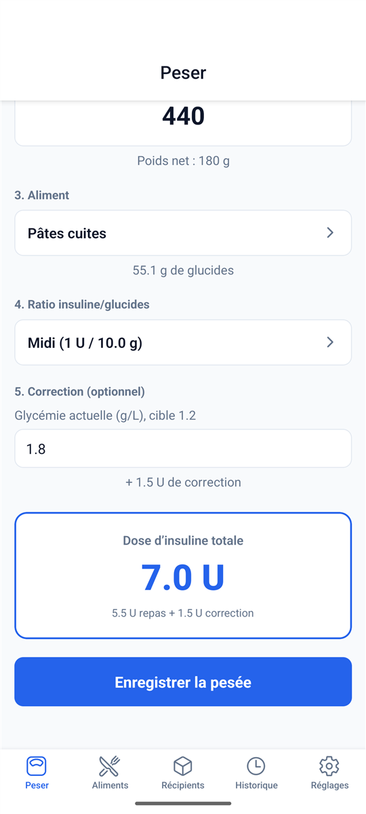

## Guide d'utilisation

L'application a cinq onglets, en bas de l'écran : **Peser**, **Aliments**, **Récipients**, **Historique** et **Réglages**.

### Premiers pas

1. **Enregistre tes récipients** habituels (onglet *Récipients*) : bols, assiettes, boîtes. C'est ce qui fait gagner le plus de temps ensuite.
2. **Ajoute les aliments** que tu manges souvent (onglet *Aliments*), ou pioche-les dans la table Ciqual au moment de peser.
3. **Sous insuline ?** Va dans *Réglages → Dose et correction* pour activer le calcul de dose, puis dans *Réglages → Ratios insuline/glucides* pour saisir tes ratios.

Sans insuline, l'étape 3 ne sert à rien : l'application s'arrête aux glucides, sans rien à configurer.

> [!TIP]
> Les nombres à virgule se tapent avec une virgule ou un point, comme ton clavier le propose : « 1,8 » et « 1.8 » donnent le même résultat.

### Peser un repas

<table>
<tr>
<td width="33%"></td>
<td width="33%">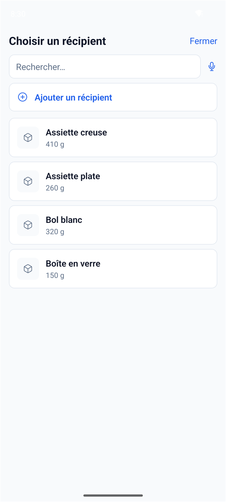</td>
<td width="33%">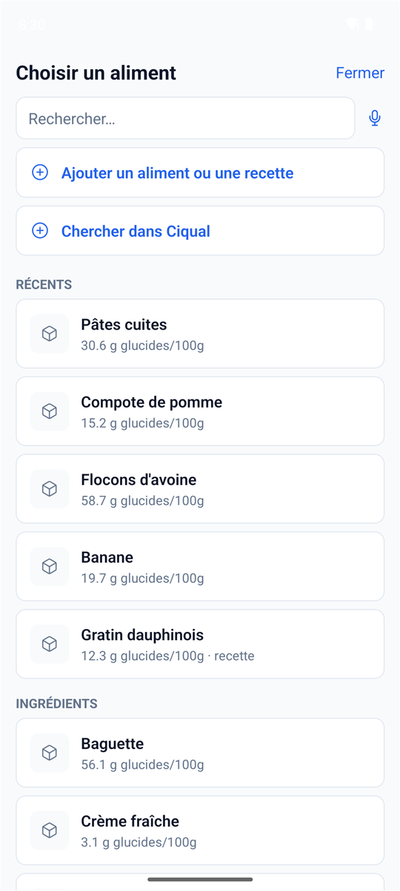</td>
</tr>
</table>

L'onglet **Peser** se remplit de haut en bas :

1. **Tare** : touche la case pour choisir le récipient. Son poids à vide est retiré automatiquement. Tu manges dans un récipient que tu n'as pas enregistré ? Choisis *Aucun récipient* et tape son poids dans *Tare manuelle*.
2. **Poids brut** : tape le poids affiché par la balance, récipient compris. Le **poids net** (l'aliment seul) s'affiche dessous. Si le poids tapé est plus petit que celui du récipient, une alerte te le signale.
3. **Aliment** : choisis-le dans la liste. Les **plus récents** sont en haut ; tape quelques lettres pour chercher, ou touche le micro pour le dicter. Un aliment absent ? *Ajouter un aliment ou une recette*, ou *Chercher dans Ciqual*. Les **glucides du repas** s'affichent aussitôt sous l'aliment.
4. **Ratio insuline/glucides** *(si le calcul de dose est activé)* : choisis le ratio du moment, par exemple « Midi ».
5. **Correction** *(facultatif, si tu as réglé une glycémie cible)* : tape ta glycémie actuelle. La correction s'ajoute à la dose repas ; une glycémie sous la cible n'enlève rien.

La carte **Dose d'insuline totale** récapitule : dose repas + correction. Touche **Enregistrer la pesée** pour la garder dans ton historique. L'écran suivant reprend le résultat et propose **Annuler cette pesée** en cas d'erreur.

> [!NOTE]
> Une pesée porte sur **un seul aliment**. Pour un plat composé (gratin, salade, gâteau…), crée une [recette](#tes-recettes) : tu la pèses ensuite comme un aliment.

### Tes récipients

<table>
<tr>
<td width="33%"></td>
<td>

L'onglet **Récipients** garde le **poids à vide** (la tare) de tes bols, assiettes et boîtes.

- **Ajouter** : bouton **+** en bas à droite. Donne un nom (« Bol bleu »), pèse le récipient vide et tape son poids. Une **photo** est facultative mais aide à reconnaître les récipients qui se ressemblent.
- **Modifier** : touche le récipient.
- **Supprimer** : fais glisser la ligne vers la gauche, ou ouvre la fiche. Les pesées déjà faites avec ce récipient restent intactes dans l'historique.

</td>
</tr>
</table>

### Tes aliments

<table>
<tr>
<td width="33%"></td>
<td width="33%">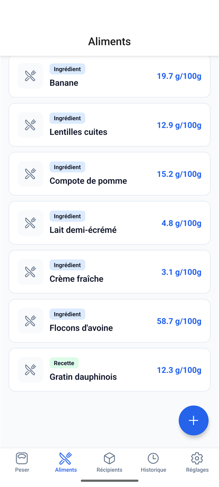</td>
<td>

L'onglet **Aliments** rassemble tes **ingrédients** et tes **recettes**, chacun avec ses **glucides pour 100 g**.

- **Ajouter** : bouton **+**, puis *Ingrédient* ou *Recette*. Pour un ingrédient, tape sa teneur en glucides (sur l'emballage, ligne « dont glucides » ou « glucides » pour 100 g), ou reprends-la de Ciqual.
- **Pèse les aliments dans l'état où tu les manges** : des pâtes cuites n'ont pas la même teneur que des pâtes sèches.
- **Modifier, supprimer** : comme pour les récipients. Un ingrédient utilisé dans une recette ne peut pas être supprimé tant que la recette l'utilise.

Modifier un aliment ne change pas les repas déjà enregistrés : l'historique garde les valeurs du jour de la pesée.

</td>
</tr>
</table>

### La table Ciqual

<table>
<tr>
<td width="33%">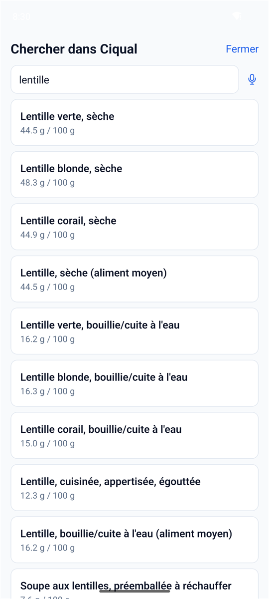</td>
<td>

**Ciqual** est la table officielle de composition des aliments publiée par l'Anses. GlucoDose en embarque plus de **3 000 aliments**, consultables **sans connexion internet**.

- Depuis l'écran Peser (*Chercher dans Ciqual*) ou en créant un ingrédient.
- Tape au moins deux lettres ; les accents ne comptent pas (« creme » trouve « crème »).
- Choisir un aliment Ciqual l'ajoute à ta liste : tu le retrouves ensuite dans tes récents.

Regarde bien l'état de l'aliment : « Lentille verte, sèche » (44,5 g) et « Lentille verte, bouillie/cuite à l'eau » (16,2 g) n'ont rien à voir.

</td>
</tr>
</table>

### Tes recettes

<table>
<tr>
<td width="33%">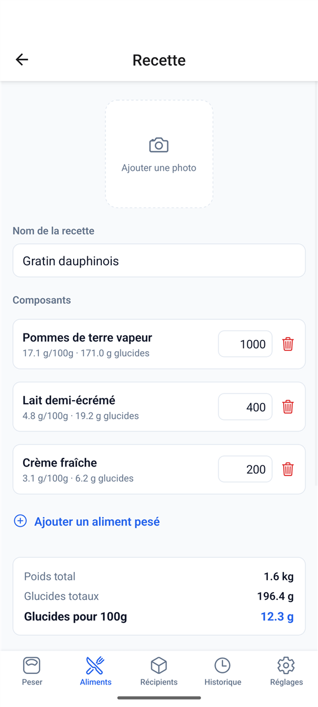</td>
<td width="33%">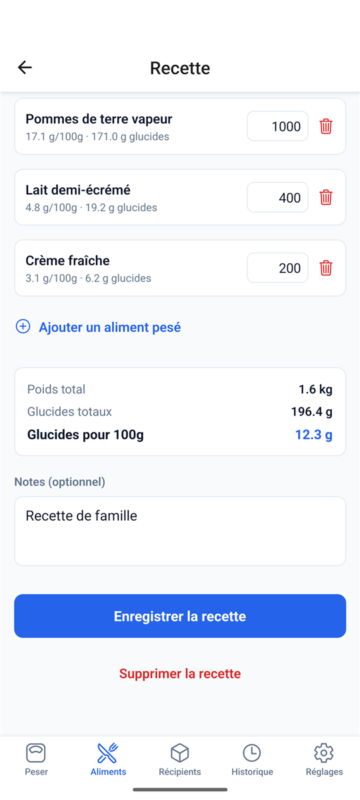</td>
<td>

Une **recette** calcule les glucides d'un plat fait maison, une fois pour toutes.

1. *Aliments* → **+** → *Recette*, puis donne-lui un nom.
2. **Ajouter un ingrédient** pour chaque ingrédient, puis tape son poids. Trois choix :
   - un aliment ou une recette **de ta liste** ;
   - **Chercher dans Ciqual** : l'aliment est ajouté à ta liste quand tu enregistres la recette (s'il y est déjà, il est réutilisé) ;
   - **Saisir un ingrédient pour cette recette** : un nom et ses glucides pour 100 g (ex. « Légumes », 6 g), sans l'ajouter à ta liste. Il reste dans la recette tant qu'elle l'utilise.
3. GlucoDose additionne : **poids des ingrédients**, **glucides totaux**, et surtout **glucides pour 100 g** du plat.

Ensuite, la recette se pèse comme n'importe quel aliment. Exemple : pommes de terre 1 000 g + lait 400 g + crème 200 g = 1,6 kg et 196,4 g de glucides, soit **12,3 g pour 100 g**.

**Poids du plat cuit** (facultatif) : un plat qui perd de l'eau à la cuisson (quiche, gratin) est plus léger une fois cuit, donc plus riche en glucides pour 100 g ; un plat qui en absorbe (riz, pâtes) l'est moins. Pèse le plat cuit (sans le récipient) et tape ce poids : les glucides pour 100 g sont alors calculés sur le plat cuit. Laissé vide, c'est la somme des ingrédients crus qui compte. Un poids cuit inférieur à 10 % ou supérieur à 4 fois le poids des ingrédients est refusé, pour attraper une faute de frappe.

</td>
</tr>
</table>

### Historique et statistiques

<table>
<tr>
<td width="33%"></td>
<td width="33%">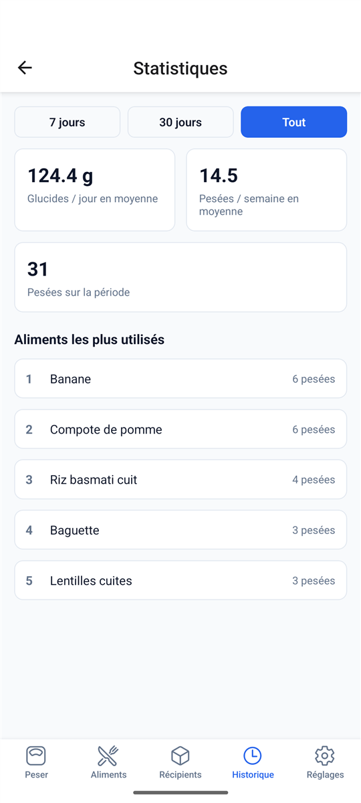</td>
<td>

L'onglet **Historique** liste tous tes repas pesés, du plus récent au plus ancien : date et heure, poids net, glucides, ratio, dose, et la part de correction avec ta glycémie.

- **Filtrer** : par aliment (champ de recherche) et par période (*Tout*, *Aujourd'hui*, *7 jours*, *30 jours*).
- **Exporter** la liste affichée : **PDF** à envoyer ou imprimer pour un rendez-vous, ou **CSV** à ouvrir dans un tableur.
- **Revoir** une pesée : touche la ligne pour rouvrir sa fiche (glucides, dose, correction).
- **Supprimer** une pesée : fais glisser la ligne vers la gauche, ou ouvre sa fiche puis *Supprimer cette pesée*.
- **Statistiques** : glucides moyens par jour, nombre moyen de pesées par semaine, nombre de pesées et aliments les plus fréquents, sur 7 jours, 30 jours ou tout l'historique.

</td>
</tr>
</table>

### Dose d'insuline et correction

<table>
<tr>
<td width="33%">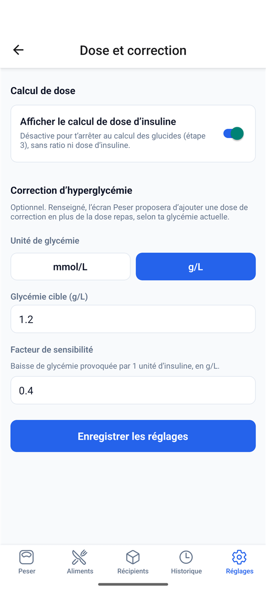</td>
<td>

*Réglages → Dose et correction* :

- **Afficher le calcul de dose d'insuline** : **désactivé par défaut**. Tant qu'il est éteint, l'écran Peser s'arrête aux glucides, sans ratio ni dose.
- **Unité de glycémie** : **mmol/L** ou **g/L**, celle de ton lecteur. Elle s'applique à la cible, au facteur et à la glycémie tapée en pesant.
- **Glycémie cible** et **facteur de sensibilité** (de combien 1 unité fait baisser ta glycémie) : facultatifs. Renseignés tous les deux, ils ajoutent l'étape *Correction* à l'écran Peser.

Ces valeurs sont personnelles : elles viennent de ton équipe soignante.

</td>
</tr>
</table>

### Ratios insuline/glucides

<table>
<tr>
<td width="33%">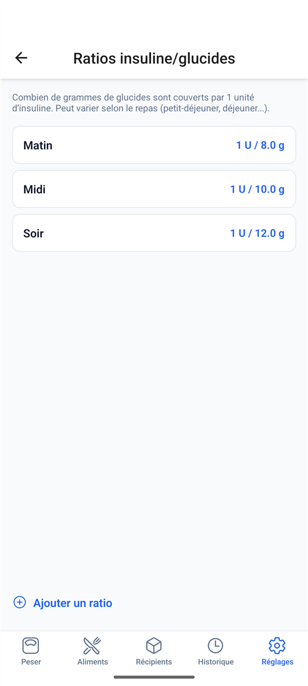</td>
<td>

*Réglages → Ratios insuline/glucides* : le nombre de **grammes de glucides couverts par 1 unité**.

- Crée-en **autant que nécessaire** (« Matin », « Midi », « Soir », « Sport »…) : les besoins varient souvent au fil de la journée.
- Touche un ratio pour le modifier ou le supprimer.
- À la pesée, tu choisis le ratio du moment. Changer un ratio plus tard ne modifie pas les doses déjà enregistrées.

</td>
</tr>
</table>

### Sauvegarde et changement de téléphone

<table>
<tr>
<td width="33%">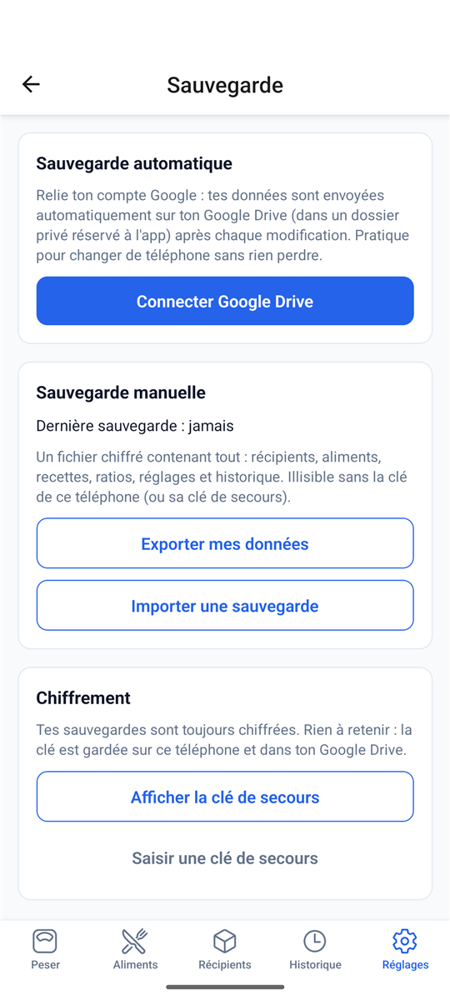</td>
<td>

*Réglages → Sauvegarde et restauration* :

- **Sauvegarde automatique** : *Connecter Google Drive*. Tes données sont envoyées après chaque modification, dans un **dossier privé** de ton Drive que seule GlucoDose peut ouvrir (il n'apparaît pas dans tes fichiers). Si l'envoi échoue durablement (espace plein, accès retiré…), une alerte te prévient et une pastille reste sur l'onglet Réglages.
- **Sauvegarde manuelle** : *Exporter mes données* crée un fichier avec tout (récipients, aliments, recettes, ratios, réglages, historique, photos). *Importer une sauvegarde* le restaure : **toutes les données actuelles sont remplacées**, après confirmation, et tu peux annuler la restauration juste après.
- **Chiffrement** : les sauvegardes sont **toujours chiffrées**, sans mot de passe à retenir. La clé est gardée sur ton téléphone et dans ton Drive. Tu n'utilises pas Drive ? Note ta **clé de secours** (*Afficher la clé de secours*) : sans elle, un fichier exporté est illisible sur un autre téléphone. Sur le nouveau téléphone, *Saisir une clé de secours* avant d'importer.

Un fichier abîmé ou modifié est refusé en entier, avec un message qui dit ce qui ne va pas : rien n'est importé à moitié.

</td>
</tr>
</table>

### Mises à jour

<table>
<tr>
<td width="33%">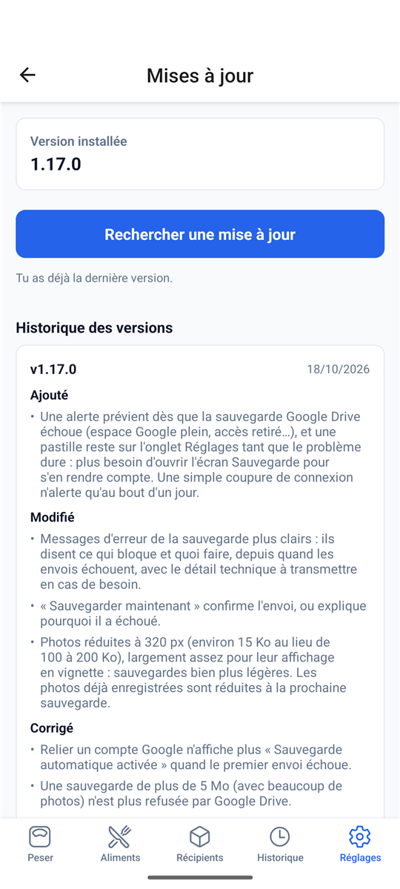</td>
<td>

Au lancement, un bandeau te prévient quand une nouvelle version est disponible. *Réglages → Mises à jour* affiche la version installée, permet de **chercher une mise à jour** et liste les **nouveautés** de chaque version.

L'installation se fait en un tap : l'application télécharge le fichier, **vérifie son empreinte** (il doit être identique à celui publié sur GitHub), puis Android te demande de confirmer. Android refuse d'ailleurs toute mise à jour qui ne viendrait pas de GlucoDose.

</td>
</tr>
</table>

### Apparence

<table>
<tr>
<td width="33%">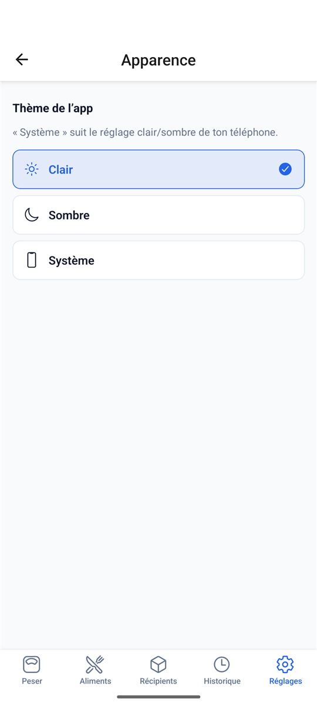</td>
<td width="33%">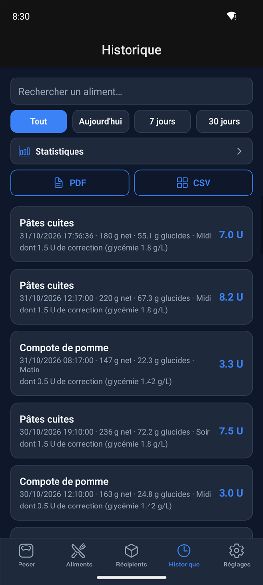</td>
<td>

*Réglages → Apparence* : thème **Clair**, **Sombre**, ou **Système** (il suit alors le réglage clair/sombre de ton téléphone).

</td>
</tr>
</table>

### Raccourcis et recherche vocale

- **Appui long sur l'icône** de GlucoDose : *Peser*, *Nouveau récipient* ou *Nouvel aliment*, directement. Tu peux aussi glisser un raccourci sur ton écran d'accueil.
- **Micro** à droite de chaque champ de recherche : dicte le nom de l'aliment, pratique quand on a les mains prises. Android demande l'autorisation du micro la première fois.
- **Réglages → Aide** résume le fonctionnement dans l'application, et **Contact** permet d'écrire par e-mail (question, bug, idée) ou de partager l'application.

## Ce que GlucoDose t'apporte

### ⏱️ Du temps gagné à chaque repas
- **Tes récipients mémorisés**, avec une photo pour les reconnaître d'un coup d'œil : plus besoin de retenir le poids de chaque bol.
- **Tes aliments mémorisés**, et les plus récents proposés en premier.
- **Plus de 3 000 aliments de la table Ciqual** (base officielle de l'Anses), consultables sans connexion internet.
- **Tes recettes maison** : pèse les ingrédients une seule fois, GlucoDose calcule les glucides du plat.
- **Recherche vocale** et **raccourcis** sur l'icône de l'app.

### ✅ Moins d'erreurs de calcul
- Aucun calcul à faire de tête : la soustraction du récipient, la règle de trois et la conversion en unités sont faites pour toi.
- Une alerte s'affiche si le poids saisi est plus petit que celui du récipient.
- Chaque repas enregistré garde les valeurs utilisées ce jour-là : si tu modifies un aliment ou un ratio plus tard, ton historique reste exact.

### 💉 Une dose d'insuline en option
- **Plusieurs ratios** possibles, par exemple un pour le matin et un pour le soir.
- **Correction** selon ta glycémie, en g/L ou en mmol/L.
- **Désactivée par défaut** : l'application n'affiche que les glucides tant que tu n'actives pas le calcul de dose.

### 🩺 Un suivi à partager avec tes soignants
- **Historique** de tous tes repas pesés, filtrable par aliment et par période.
- **Export PDF** pour ton rendez-vous, ou **CSV** pour l'analyser toi-même.
- **Statistiques** : glucides moyens par jour, pesées par semaine, aliments les plus fréquents.

### 🔒 Tes données restent les tiennes
- **Aucun compte à créer**, aucune publicité, aucun suivi.
- **Tout est stocké sur ton téléphone** et fonctionne sans internet.
- **Sauvegarde facultative sur ton Google Drive**, chiffrée et rangée dans un dossier privé que seule l'application peut ouvrir.

## Petit lexique

| Terme | En clair |
|---|---|
| **Glucides** | Les sucres et féculents d'un aliment, ceux qui font monter la glycémie. On les compte en grammes. |
| **Tare** | Le poids du récipient vide, à retirer de la pesée pour n'avoir que l'aliment. |
| **Poids brut / net** | Brut : récipient compris, ce qu'affiche la balance. Net : l'aliment seul. |
| **Ratio insuline/glucides** | Le nombre de grammes de glucides « couverts » par 1 unité d'insuline. Fixé avec ton équipe soignante. |
| **Facteur de sensibilité** | De combien 1 unité d'insuline fait baisser ta glycémie. Sert à calculer la correction. |
| **Correction** | La petite dose ajoutée quand la glycémie avant le repas est au-dessus de ta cible. |
| **Ciqual** | La table de composition nutritionnelle des aliments publiée par l'Anses, l'agence sanitaire française. |

## Installer GlucoDose

GlucoDose est disponible **pour Android**. Il n'est pas (encore) sur le Play Store : il s'installe depuis cette page.

1. Sur ton téléphone, ouvre la [**dernière version**](https://github.com/Forthtilliath/glucodose/releases/latest) et télécharge le fichier `GlucoDose-<version>.apk`.
2. Ouvre le fichier téléchargé. Android te demande d'autoriser l'installation depuis ton navigateur : accepte.
3. C'est installé ! Les mises à jour suivantes te sont proposées directement dans l'application.

> [!TIP]
> Il te faut une balance de cuisine, n'importe laquelle. Commence par enregistrer tes bols et assiettes habituels (onglet *Récipients*) : c'est ce qui fait gagner le plus de temps ensuite.

## Questions fréquentes

<b>Je ne suis pas sous insuline, l'application m'est-elle utile ?</b>

Oui. Compter les glucides est son rôle premier, et le calcul de dose est désactivé par défaut : tu ne vois que les glucides, sans rien à configurer.

<b>Est-ce que GlucoDose remplace mon médecin ou mon diabétologue ?</b>

Non. Il fait les calculs à partir des valeurs que ton équipe soignante t'a données, mais il ne décide de rien à ta place. Garde toujours un regard critique sur le résultat.

<b>Mon assiette contient plusieurs aliments, comment faire ?</b>

Une pesée porte sur un seul aliment. Deux solutions : peser chaque aliment séparément (une pesée chacun, en remettant la balance à zéro entre deux), ou, pour un plat que tu refais souvent, créer une [recette](#tes-recettes).

<b>Faut-il une connexion internet ?</b>

Non. Tout fonctionne hors ligne, y compris la recherche dans la table Ciqual. Internet n'est utile que pour la sauvegarde Google Drive (facultative) et la vérification des mises à jour.

<b>Qui peut voir mes données ?</b>

Personne d'autre que toi : elles restent sur ton téléphone, et l'application n'envoie rien à personne. Si tu actives la sauvegarde Google Drive, le fichier est chiffré avant de quitter ton téléphone, puis rangé dans un dossier caché de ton Drive que seule GlucoDose peut ouvrir : il n'apparaît pas dans tes fichiers et aucune autre application n'y a accès.

<b>Et si je change de téléphone ?</b>

Avec la sauvegarde Google Drive, il suffit de te reconnecter sur le nouveau téléphone pour tout retrouver. Sans Drive, exporte un fichier de sauvegarde depuis *Réglages → Sauvegarde et restauration* et importe-le sur le nouvel appareil, après y avoir saisi ta clé de secours (affichée sur le même écran).

<b>J'ai enregistré une pesée par erreur.</b>

Juste après l'enregistrement, touche *Annuler cette pesée*. Plus tard, dans l'*Historique*, fais glisser la ligne vers la gauche pour la supprimer.

<b>Est-ce disponible sur iPhone ?</b>

Non, GlucoDose est développé uniquement pour Android.

<b>C'est vraiment gratuit ?</b>

Oui : pas de publicité, pas d'abonnement, pas de version payante. Si l'application te rend service, tu peux soutenir son développement en m'[offrant un café](https://buymeacoffee.com/forthtilliath) ☕.

## Soutenir le projet

GlucoDose est développé sur mon temps libre. Tu peux aider :

- en [signalant un problème ou en proposant une idée](https://github.com/Forthtilliath/glucodose/issues) ;
- en parlant de l'application autour de toi ;
- en [m'offrant un café](https://buymeacoffee.com/forthtilliath) ☕.

## Pour les développeurs

Compilation, architecture, méthode de calcul, base de données, sauvegarde chiffrée, signature et publication : tout est dans le **[README développeurs](./docs/README.md)**.

## Licence

GlucoDose est distribué sous [licence MIT](./LICENSE) : tu peux librement l'utiliser, le modifier et le partager.
