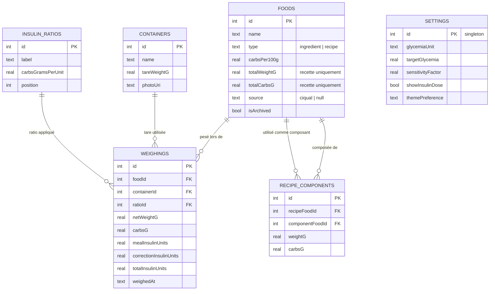

# GlucoDose — README développeurs

Tout ce qu'il faut pour compiler GlucoDose et travailler sur son code. La présentation de l'app (fonctionnalités, captures, FAQ) est dans le [README principal](../README.md).

> [!CAUTION]
> GlucoDose calcule des doses d'insuline. Toute modification d'un calcul, d'une saisie numérique ou de l'import des sauvegardes doit être couverte par un test : une erreur ici ne se voit pas à l'écran, elle se retrouve dans une injection.

## Sommaire

- [Stack](#stack)
- [Démarrer](#démarrer)
- [Arborescence](#arborescence)
- [Méthode de calcul](#méthode-de-calcul)
- [Saisie des nombres](#saisie-des-nombres)
- [Base de données](#base-de-données)
- [Aliments, recettes et Ciqual](#aliments-recettes-et-ciqual)
- [Photos](#photos)
- [Sauvegarde, chiffrement et Google Drive](#sauvegarde-chiffrement-et-google-drive)
- [Mises à jour intégrées](#mises-à-jour-intégrées)
- [Raccourcis et widget](#raccourcis-et-widget)
- [Tests et CI](#tests-et-ci)
- [Signer l'APK de release](#signer-lapk-de-release)
- [Versions et publication](#versions-et-publication)
- [Captures d'écran du README](#captures-décran-du-readme)

## Stack

| Domaine | Choix |
|---|---|
| Framework | [Expo](https://expo.dev) SDK 57, React Native 0.86, React 19, [Expo Router](https://docs.expo.dev/router/introduction/) (onglets typés) |
| Langage | TypeScript strict |
| Base de données | SQLite embarqué (`expo-sqlite`) via [Drizzle ORM](https://orm.drizzle.team/docs/get-started/expo-new) : schéma typé, migrations versionnées, requêtes réactives (`useLiveQuery`) |
| État | Hooks React + requêtes SQL réactives, sans state manager global |
| Natif | `expo-image-picker` / `expo-image-manipulator` (photos), `expo-speech-recognition` (recherche vocale), `expo-quick-actions` (raccourcis d'icône), `expo-print` + `expo-sharing` (PDF, CSV), `expo-secure-store` (clé de chiffrement) |
| Paquets maison | [`@forthtilliath/react-native-kit`](https://github.com/Forthtilliath/forthtilliath-packages/tree/main/packages/react-native-kit#readme) (`PickerModal`, `SwipeableRow`, écrans de réglages), [`@forthtilliath/ts-kit`](https://github.com/Forthtilliath/forthtilliath-packages/tree/main/packages/ts-kit#readme) (`escapeHtml`…), [`expo-backup`](https://github.com/Forthtilliath/forthtilliath-packages/tree/main/packages/expo-backup#readme) / `expo-backup-ui`, [`expo-release-updates`](https://github.com/Forthtilliath/forthtilliath-packages/tree/main/packages/expo-release-updates#readme) / `expo-release-updates-ui` |
| Données | 100 % locales, aucun backend, aucun compte ; Internet seulement pour Google Drive (facultatif) et la vérification des mises à jour |
| Plateforme | **Android uniquement**, identifiant `com.forth.glucodose` (historique : ne pas le changer, Android y verrait une autre app et les données seraient perdues) |

## Démarrer

Prérequis : Node.js ≥ 20, le SDK Android, un téléphone ou un émulateur.

```bash
npm install --legacy-peer-deps   # voir la note dans .github/workflows/ci.yml
npx expo run:android             # build de développement, installé sur l'appareil branché
```

> [!IMPORTANT]
> **Expo Go ne suffit pas** : l'app utilise des modules natifs (photos, recherche vocale, raccourcis d'icône). Sans eux, l'écran Peser plante dès l'ouverture. Il faut un build de développement (`npx expo run:android`).

| Commande | Effet |
|---|---|
| `npm start` | Metro seul, pour un build de développement déjà installé |
| `npm run android` | Build de développement et lancement sur Android |
| `npm test` | Tests (Jest) |
| `npx tsc --noEmit` | Vérification TypeScript |
| `npm run lint` | Lint (`expo lint`) |
| `npx drizzle-kit generate` | Génère une migration après modification de `src/db/schema.ts` |
| `npm run import-ciqual` | Reconvertit la table Ciqual (Anses) en `assets/data/ciqual.json` |
| `npm run generate-icons` | Régénère les icônes de l'app |

## Arborescence

```
src/
├── app/                        écrans (Expo Router) — aucun test ici, voir « Tests et CI »
│   ├── _layout.tsx             migrations au démarrage, splash, raccourcis d'icône, notifieurs
│   ├── (tabs)/index.tsx        Peser
│   ├── (tabs)/foods/           Aliments : liste, ingrédient, recette, choix du type
│   ├── (tabs)/containers/      Récipients : liste, fiche
│   ├── (tabs)/history/         Historique, statistiques
│   ├── (tabs)/settings/        Dose et correction, ratios, sauvegarde, apparence, mises à jour,
│   │                           aide, contact, à propos, mentions légales
│   └── weighing-result/[id].tsx  résultat après enregistrement (« Annuler cette pesée »)
├── components/                 bandeau et notifieur de mise à jour, alerte de sauvegarde en échec,
│                               morceaux d'écrans (weigh/, ingredient/, recipe/, history/)
├── db/                         schéma Drizzle, connexion SQLite, écritures (repository.ts)
├── lib/                        calculs (insulin.ts), saisie (parseDecimal.ts), Ciqual, sauvegarde,
│                               photos, exports PDF/CSV, statistiques, mises à jour, raccourcis
├── theme/colors.ts             palettes claire et sombre
├── widgets/                    widget d'écran d'accueil (désactivé, voir plus bas)
└── __tests__/                  tests des écrans (hors de src/app)
assets/data/ciqual.json         table Ciqual pré-traitée (~3 300 aliments)
drizzle/                        migrations SQL générées (versionnées)
plugins/                        config plugins Expo : signature release, ABI ARM
scripts/                        import Ciqual (source .xlsx incluse), génération des icônes
```

## Méthode de calcul

Toutes les formules sont dans [`src/lib/insulin.ts`](../src/lib/insulin.ts), testées dans `insulin.test.ts` :

```
poids net        = poids brut − tare
glucides pesés   = poids net × (glucides pour 100 g) ÷ 100
dose repas       = glucides pesés ÷ ratio (g de glucides couverts par 1 U)
dose correction  = max(0, (glycémie actuelle − glycémie cible) ÷ facteur de sensibilité)
dose totale      = dose repas + dose correction
```

- Les glucides pour 100 g sont une propriété stable de l'aliment, le ratio un paramètre personnel qui varie selon le repas : les deux sont stockés séparément.
- **Chaque pesée fige les valeurs utilisées** (`*Snapshot` : nom de l'aliment, glucides pour 100 g, ratio, glycémie cible, facteur, unité) : modifier un aliment ou un ratio ne change jamais une dose déjà calculée.
- Le calcul de dose est **désactivé par défaut** (`settings.showInsulinDose = false`, migration `0006_dose_off_by_default`) : l'écran Peser s'arrête alors aux glucides, et la pesée est enregistrée sans aucune valeur d'insuline. Les sauvegardes antérieures à ce réglage sont restaurées avec la dose affichée, comme avant.
- La correction n'apparaît que si la glycémie cible **et** le facteur de sensibilité sont renseignés ; une glycémie sous la cible ne retire rien (`max(0, …)`).
- L'unité (mmol/L ou g/L) s'applique à la glycémie cible, au facteur et à la saisie : rien n'est converti.

## Saisie des nombres

Toute saisie numérique passe par [`parseDecimal`](../src/lib/parseDecimal.ts), **jamais `parseFloat`** :

- selon le clavier et la langue du téléphone, le séparateur décimal est un point ou une virgule ; `parseFloat("1,8")` renvoie `1` sans erreur, ce qui faussait en silence une glycémie, un ratio ou un poids ;
- `parseDecimal` accepte les deux séparateurs et renvoie `NaN` pour toute saisie incomplète (`""`, `"1,8,2"`, `"12abc"`) : l'écran la refuse au lieu d'en garder le début.

Un champ numérique ajouté doit l'utiliser, avec un test qui tape une virgule (voir `src/__tests__/app/index.test.tsx`).

## Base de données



- **Source de vérité** : [`src/db/schema.ts`](../src/db/schema.ts). `npx drizzle-kit generate` produit un fichier SQL dans `drizzle/`, appliqué automatiquement au démarrage (`src/app/_layout.tsx`). Ne jamais modifier une migration publiée : en générer une nouvelle.
- Les clés étrangères de l'historique sont en `ON DELETE SET NULL` : supprimer un aliment, un récipient ou un ratio garde les pesées, avec leurs valeurs figées. Côté recettes, supprimer une recette supprime ses composants (`cascade`), mais un ingrédient utilisé dans une recette ne peut pas être supprimé (`restrict`).
- Écritures regroupées dans [`src/db/repository.ts`](../src/db/repository.ts), qui réexporte celles des aliments et recettes ([`foodRepository.ts`](../src/db/foodRepository.ts)) (testées sur une vraie base SQLite en mémoire, `testDb.ts`).
- `settings` est une ligne unique (`id = 1`). Les colonnes `widgetSelected*` servent au widget désactivé.
- Les dates `current_timestamp` de SQLite sont en UTC sans fuseau : toujours les lire avec `parseDbDate` (`src/lib/dbDate.ts`).

## Aliments, recettes et Ciqual

- **Ingrédient** : glucides pour 100 g saisis à la main, ou repris de Ciqual (`source = "ciqual"`).
- **Recette** : liste de composants pesés ; glucides totaux = somme des composants. Poids total = **poids du plat cuit** s'il est saisi, sinon somme des composants crus ; les glucides pour 100 g en découlent ([`src/lib/recipeTotals.ts`](../src/lib/recipeTotals.ts), bornes 10 %–400 % du cru). Pas de colonne dédiée : un `foods.totalWeightG` différent de la somme des composants **est** le poids cuit (`storedCookedWeight`). Une recette se pèse ensuite comme n'importe quel aliment.
- **Ingrédients ajoutés depuis une recette** ([`src/db/foodRepository.ts`](../src/db/foodRepository.ts)) : créés seulement à l'enregistrement de la recette. Depuis Ciqual → ingrédient normal ; saisie manuelle → ingrédient **archivé** (`isArchived`), absent des listes. Un aliment archivé n'existe que pour les recettes : quand plus aucune ne l'utilise (composant retiré, recette supprimée), il est supprimé avec sa photo. L'écran de recette charge les aliments archivés, sinon leurs glucides compteraient pour 0 au réenregistrement.
- **Ciqual** : `assets/data/ciqual.json` (≈ 3 300 aliments, nom + glucides + groupe) est généré par `npm run import-ciqual` à partir de `scripts/ciqual-source/Table_Ciqual_2025_FR.xlsx`. Recherche locale dans [`src/lib/ciqual.ts`](../src/lib/ciqual.ts) (insensible aux accents, 2 caractères minimum), aucun appel réseau.
- **Recherche vocale** : bouton micro du `PickerModal` du kit (`expo-speech-recognition`, permission demandée au premier usage).

## Photos

Photo facultative pour un récipient ou un aliment (`src/lib/photos.ts`) : prise ou choisie, **réduite à 320 px** (`expo-image-manipulator`, ≈ 15 Ko), copiée dans le dossier de l'app. Les photos voyagent dans les sauvegardes (`photos` : base64 vérifié par `backupPhotoValidation.ts`) ; les fichiers orphelins sont nettoyés après une restauration.

## Sauvegarde, chiffrement et Google Drive

La sauvegarde vient des paquets partagés [`@forthtilliath/expo-backup`](https://github.com/Forthtilliath/forthtilliath-packages/tree/main/packages/expo-backup#readme) et `expo-backup-ui`, configurés dans [`src/lib/backupManager.ts`](../src/lib/backupManager.ts) :

- **Contenu** (`src/lib/backup.ts`) : toutes les tables + les photos, `schemaVersion: 1`. Une restauration **remplace tout** (pas de fusion), dans une transaction ; l'état actuel est sauvegardé juste avant.
- **Chiffrement obligatoire** (données de santé) : fichiers exportés et copie Drive sont chiffrés (XChaCha20-Poly1305) avec une clé générée par l'app, gardée dans le Keystore Android (`expo-secure-store`) et déposée dans le dossier privé Drive de l'app. Rien à retenir pour l'utilisateur ; une clé de secours est consultable dans l'écran pour qui n'utilise pas Drive. Les anciens exports en clair restent importables.
- **Drive** : uniquement le dossier caché de l'app (scope `drive.appdata`), envoi automatique quelques secondes après chaque modification (`useAutoBackup.ts`). Un échec persistant déclenche une alerte et une pastille sur l'onglet Réglages (`BackupProblemNotifier`) ; une simple coupure réseau n'alerte qu'au bout d'un jour.
- **`android.allowBackup: false`** (`app.json`) : la sauvegarde automatique d'Android copierait sinon la base en clair hors du téléphone.
- **Import vérifié** (`parseBackup`) : JSON → forme générale → [`backupValidation.ts`](../src/lib/backupValidation.ts), **un schéma zod par table** (types, bornes physiques, énumérations, longueur maximale des textes, format des dates, nombre maximal de lignes par table) → identifiants uniques et composants de recette existants → photos ([`backupPhotoValidation.ts`](../src/lib/backupPhotoValidation.ts) : base64, type réel de l'image, une par ligne). Clés inconnues retirées, **rejet du fichier entier** à la première anomalie avec un message affichable (« foods[3] : « name » invalide. »). Les références orphelines de l'historique sont détachées, comme le ferait `ON DELETE SET NULL`. À la restauration, un `photoUri` hors du dossier photos de l'app est ignoré.
- Toute nouvelle colonne : l'ajouter au schéma de sa table **avec ses bornes**, et un test dans `backupValidation.test.ts`.

Configuration Google Cloud (une fois) : activer l'API Google Drive, déclarer le scope `drive.appdata` dans l'écran de consentement OAuth, puis créer un client OAuth **Android** avec le nom de paquet `com.forth.glucodose` et l'empreinte **SHA-1 de la clé de release** (`keytool -list -v -keystore glucodose-upload.keystore`). Détails : README d'`expo-backup`.

## Mises à jour intégrées

[`src/lib/appUpdate.ts`](../src/lib/appUpdate.ts) (dépôt `Forthtilliath/glucodose`) :

- `fetchLatestRelease` ne propose que les releases dont GitHub donne l'empreinte SHA-256 de l'APK (`requireVerifiedApk`) ;
- `downloadAndInstallApk` refuse une release sans empreinte, vérifie le SHA-256 du fichier téléchargé et n'accepte que les URL des releases du dépôt (`allowedUrlPrefix`), puis confie l'APK à l'installeur d'Android (qui refuse en plus un APK signé avec une autre clé) ;
- les notes de version GitHub sont simplifiées (`simplifyReleaseNotes`) pour l'affichage : `ChangelogNotes` ne comprend que les titres `###`, les puces et le gras.

Le bandeau du lancement (`UpdateNotifier`, `UpdateBanner`) et l'écran Réglages ▸ Mises à jour (version installée, historique des versions) viennent d'`expo-release-updates-ui`.

## Raccourcis et widget

- **Raccourcis d'icône** (appui long sur l'icône) : *Peser*, *Nouveau récipient*, *Nouvel aliment* — définis et routés dans [`src/lib/quickActions.ts`](../src/lib/quickActions.ts), branchés dans `src/app/_layout.tsx`.
- **Widget d'écran d'accueil** (`src/widgets/`, `react-native-android-widget`) : récipient et aliment récents, bouton Peser. **Désactivé** : retiré de la liste `widgets` du plugin dans `app.json`, le code est gardé pour plus tard. Ne pas le présenter dans le README utilisateur tant qu'il n'est pas réactivé.

## Tests et CI

```bash
npm test             # Jest
npx tsc --noEmit
npm run lint
```

- **Aucun fichier de test sous `src/app/`** : Expo Router y charge chaque fichier comme une route, y compris dans le bundle de production. Les tests d'écran vont dans `src/__tests__/app/…`, les autres à côté du code (`src/lib/*.test.ts`, `src/db/repository.test.ts`).
- Les tests d'écran simulent Drizzle (`useLiveQuery`), le routeur et le `PickerModal` du kit ; les formules et la base sont testées pour de vrai.
- **CI** (`.github/workflows/ci.yml`) : sur les PR vers `main` seulement, hors brouillons, ignorée pour les `.md` et `docs/` ; `tsc` puis `jest`, environ 1 à 2 min. Lancer aussi le lint en local avant de pousser, la CI ne le fait pas.

## Signer l'APK de release

L'APK de release est signé avec une clé propre à GlucoDose, jamais avec le `debug.keystore` public de React Native (plugin [`plugins/withReleaseSigning.js`](../plugins/withReleaseSigning.js), testé dans `plugins/__tests__`). Sans cette clé, `gradlew assembleRelease` échoue (« Keystore file not set »).

1. Générer la clé une seule fois, **hors du dépôt**, et la sauvegarder (gestionnaire de mots de passe) : la perdre empêche toute mise à jour de l'app installée.

   ```powershell
   keytool -genkeypair -v -storetype PKCS12 -keyalg RSA -keysize 2048 -validity 10000 -alias glucodose-upload -keystore "$env:USERPROFILE\keys\glucodose-upload.keystore"
   ```

2. Déclarer son emplacement et son mot de passe dans `~/.gradle/gradle.properties` (jamais dans `android/`, régénéré par `expo prebuild`) :

   ```properties
   GLUCODOSE_UPLOAD_STORE_FILE=C:/Users/<toi>/keys/glucodose-upload.keystore
   GLUCODOSE_UPLOAD_STORE_PASSWORD=...
   GLUCODOSE_UPLOAD_KEY_ALIAS=glucodose-upload
   GLUCODOSE_UPLOAD_KEY_PASSWORD=...
   ```

3. Vérifier avec `cd android && ./gradlew :app:signingReport` (section `Variant: release`).

L'APK n'embarque que le code natif des téléphones ARM (plugin [`plugins/withAndroidAbis.js`](../plugins/withAndroidAbis.js)).

## Versions et publication

1. Noter les changements dans [`CHANGELOG.md`](../CHANGELOG.md) ([Keep a Changelog](https://keepachangelog.com/fr/1.1.0/), en français : c'est le texte que l'app affiche dans Réglages ▸ Mises à jour).
2. Monter `version` et `android.versionCode` dans `app.json` ([semver](https://semver.org/lang/fr/)).
3. Build : `npx expo prebuild --platform android --clean`, puis `cd android && ./gradlew assembleRelease`.
4. Release GitHub avec l'APK **renommé `GlucoDose-<version>.apk`** et les notes du CHANGELOG : GitHub calcule l'empreinte SHA-256 que l'app exige avant de proposer la mise à jour.

La branche `main` est protégée : tout changement passe par une branche dédiée et une Pull Request, intégrée en rebase.

## Captures d'écran du README

Les captures de [`screenshots/`](screenshots/) viennent de l'émulateur Pixel 6 (1080 × 2400), réduites à 540 × 1200, avec des données fictives :

1. Build release pour l'émulateur (les APK publiés, ARM uniquement, ne démarrent pas sur un émulateur x86_64) :
   ```bash
   npx expo prebuild --platform android
   cd android && ./gradlew assembleRelease -PreactNativeArchitectures=x86_64
   adb install -r app/build/outputs/apk/release/app-release.apk
   ```
2. Sauvegarde de démonstration **en clair** (4 récipients, 10 ingrédients, une recette « Gratin dauphinois », ratios Matin 8 g / Midi 10 g / Soir 12 g, glycémie en g/L avec cible 1,2 et facteur 0,4, une trentaine de pesées sur deux semaines, au format JSON de `buildExportedData` non chiffré), poussée par `adb push demo.json /sdcard/Download/` puis importée par Réglages ▸ Sauvegarde et restauration ▸ Importer une sauvegarde.
3. Barre d'état en mode démo :
   ```bash
   adb shell settings put global sysui_demo_allowed 1
   adb shell am broadcast -a com.android.systemui.demo -e command enter
   adb shell am broadcast -a com.android.systemui.demo -e command clock -e hhmm 2030
   adb shell am broadcast -a com.android.systemui.demo -e command notifications -e visible false
   ```
4. `adb shell screencap -p /sdcard/s.png` puis `adb pull /sdcard/s.png`, réduire à 540 × 1200.
